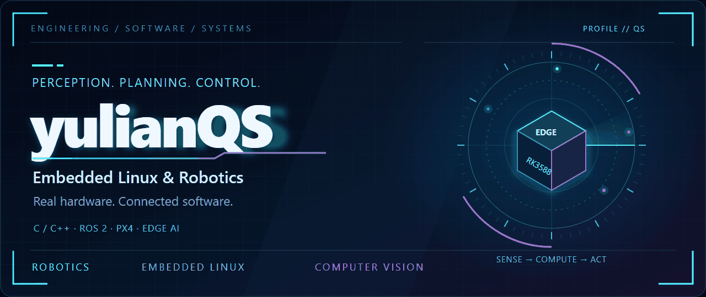
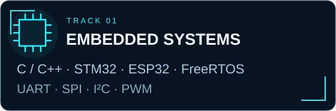
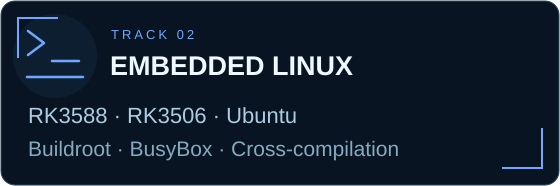
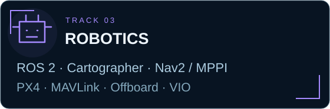
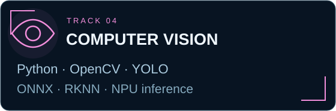
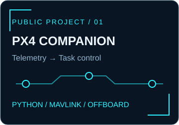
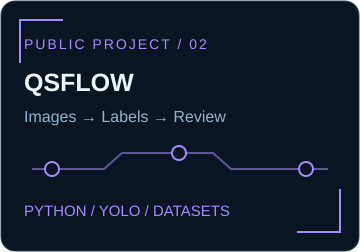
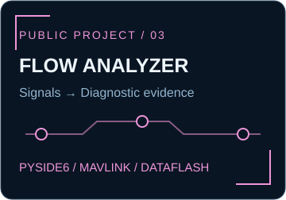

  <a href="https://github.com/yulianQS">English</a> · <strong>简体中文</strong>

  <picture>
    <source media="(prefers-reduced-motion: reduce)" srcset="assets/hero.svg" />
    
  </picture>

# 嵌入式 Linux 与机器人软件开发者

**从感知到运动，连接嵌入式硬件、机器人与边缘视觉。**

## 01 / 关于我

我的工程实践涉及嵌入式软件、机器人控制和视觉应用，关注如何在实际硬件上连接感知与运动执行。

- **自主导航：** 建图、定位、路径导航与移动机器人控制。
- **无人机集成：** 飞控通信、伴随计算机与视觉定位。
- **嵌入式 Linux：** 板端部署、交叉编译与软硬件协同开发。
- **边缘视觉：** 模型转换、端侧推理与运动控制中的视觉反馈。

## 02 / 技术栈

  
  
  
  

查看完整文字技术栈

| 方向 | 在项目与工程实践中使用的技术 |
| :--- | :--- |
| **嵌入式系统** | C / C++、STM32、ESP32、FreeRTOS · UART、SPI、I²C、PWM |
| **嵌入式 Linux** | RK3588、RK3506 · Ubuntu、Buildroot、BusyBox、Shell、交叉编译 |
| **机器人** | ROS 2 Humble、TF、里程计 · Cartographer、Nav2、MPPI · PX4、MAVLink、Offboard、VIO |
| **计算机视觉** | Python、OpenCV、YOLO · ONNX、RKNN、NPU 推理 |

## 03 / 精选公开项目

  
  
  

> **PX4 验证状态：** 已记录台架集成结果，实际飞行行为仍需验证。

展开项目说明与验证状态

### 01 · [PX4 伴随计算机控制](https://github.com/yulianQS/px4-companion-control)

**飞控通信 → 遥测反馈 → 运动任务协同**

围绕 MAVLink 通信、Offboard 集成与网页控制界面开发的伴随计算机项目。代码包含相对运动任务、反馈处理、超时与取消逻辑。

`Python` `PX4` `MAVLink` `Offboard`

> **当前状态：** 已记录台架集成结果。起飞、悬停、平移与降落行为仍需实际飞行验证。

### 02 · [QSflow](https://github.com/yulianQS/QSflow)

**图像 → 辅助标注 → 审阅 → 检测数据集**

本地优先的目标检测标注桌面应用。支持 Pascal VOC、YOLO Detection 和 COCO Detection，提供模型辅助标注、标注审阅与轻量训练流程。

`Python` `YOLO` `计算机视觉` `桌面工具`

> **工程重点：** 使用统一标注数据模型，连接人工编辑、模型推理与数据集审阅。

### 03 · [ArduPilot 光流分析工具](https://github.com/yulianQS/ardupilot-flow-analyzer)

**MAVLink / DataFlash → 同步信号 → 诊断依据**

面向光流、测距与飞控遥测的 Windows 诊断应用，结合本地日志解析、联动曲线与基于实际数据的 Loiter 筛查。

`Python` `PySide6` `MAVLink` `ArduPilot` `DataFlash`

> **工程重点：** 飞控只读通信、后台解析，以及对数据缺失或证据不足情况的明确处理。

## 04 / 工程实践

- **自主导航机器人：** RK3588 搭配 ROS 2 Humble、Cartographer 与 Nav2 MPPI，通过分层控制架构连接导航、STM32 底盘控制器与 ESP32 通信模块。
- **视觉引导拼图：** 使用 Python 与 OpenCV 提取轮廓、进行几何匹配，并连接路径规划与电机执行流程。
- **RK3588 边缘推理：** YOLO 模型经过 PyTorch → ONNX → RKNN 转换，在板端进行 NPU 推理。
- **视觉与运动协同：** RK3588 提取目标偏差，联动 STM32 双轴云台与步进电机控制。
- **RK3506 系统开发：** Buildroot 部署、看门狗集成与内存带宽测试。

---

[浏览我的公开仓库 →](https://github.com/yulianQS?tab=repositories)
